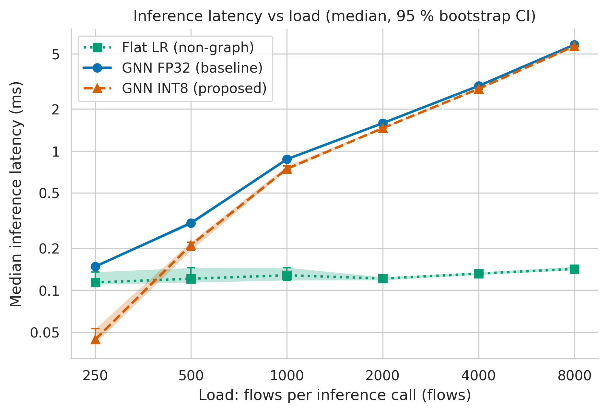
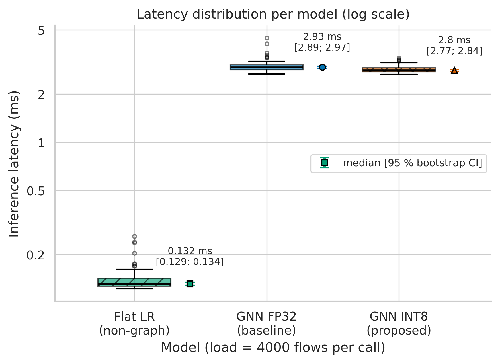

# Zero-Day Attack Detection in IoT Networks via Graph Neural Networks: From Classical Architectures to Quantum and Quantized Models

[](https://www.python.org/downloads/release/python-3119/)
[](https://opensource.org/licenses/MIT)
[](Dockerfile)

An empirical benchmarking framework evaluating classical, quantized (`INT8`), and exploratory quantum-enhanced (`QGNN`) Graph Neural Network architectures for real-time zero-day intrusion detection in edge-constrained IoT environments.

> **Status (Task 3, Weeks 7-9).** Raw timing logs, aggregated metrics, an executed analysis notebook, publication-ready figures and a formal domain model are included (see [Results & Discussion](#9-results--discussion)). The models are still the Weeks 5-6 skeleton (parameter-free graph propagation + linear head, quantum model is a stub), and the flow stream used for the Task 3 timings is **synthetic** (seeded). Latency values are real measurements of this code; detection metrics only verify the pipeline and are **not** scientific results.

---

## Authors & Affiliation
* **Kutmyrza Aziza** — [GitHub](https://github.com/aziza-ops)
* **Kuat Aruzhan** — [GitHub](https://github.com/aruzhankuat)

---

## 1. Research Overview & Questions

Internet of Things (IoT) ecosystems face increasingly sophisticated, non-stationary cyber threats. Traditional flat-feature detectors struggle against unstudied zero-day exploits whose statistical signatures mutate. While Graph Neural Networks (GNNs) capture relational communication topologies, full-precision models suffer high memory footprint and execution latency on resource-constrained edge nodes.

This research addresses two core FINER research questions:
* **RQ1 (Optimization & Edge Efficiency):** *How do quantized (INT8) and quantum-enhanced GNN architectures compare to classical FP32 GNNs in terms of execution latency and memory footprint when deployed on edge IoT nodes?*
* **RQ2 (Causal Detection & Generalization):** *To what extent does graph topological encoding improve zero-day (unseen) intrusion detection precision and lower false alarm rates compared to non-graph baseline detectors?*

### Testable Hypotheses
* **H1 (Quantization on Edge):** Under a strict leave-one-attack-out zero-day protocol, the INT8 quantized GNN reduces median inference latency by at least 30 % and model size / peak memory by at least 40 % compared to the FP32 GNN, while keeping precision on the test set >= 0.92 and F1 degradation <= 0.02 (absolute). The 30 % threshold is checked with the upper limit of a 95 % bootstrap confidence interval of the latency ratio INT8/FP32 (must be below 0.70); F1 non-inferiority uses a paired Wilcoxon signed-rank test (p < 0.05). *The quantum GNN is evaluated on a simulator as an exploratory baseline only.*
* **H2 (Topological Advantage):** Graph message passing improves F1 (attack class) on unseen zero-day attacks by at least 0.15 (absolute) over flat-feature baselines, with statistical significance (Wilcoxon signed-rank, p < 0.05) and without increasing the false positive rate (FPR_GNN <= FPR_flat).

Replicates for the tests are (attack family x data subsample) pairs; at least 6 pairs are required (subsample seeds 0-4).

---

## 2. Repository Directory Layout

```
iot-gnn-zeroday-benchmark/
├── .gitignore                       # No caches, checkpoints, venvs, heavy raw dumps
├── Dockerfile                       # Controlled edge environment (python:3.11.9-slim; limits applied at docker run)
├── LICENSE                          # MIT Open-Source License
├── README.md                        # This file (results table + embedded plots)
├── requirements.txt                 # Exact pinned dependencies of the benchmark harness
├── requirements-analysis.txt        # Extra deps for analysis / plots (matplotlib, seaborn, scipy, pillow)
├── config.yaml                      # Centralized experiment parameters (edit here, not in code)
├── data/
│   ├── raw/test_run.jsonl           # Raw benchmark log: 1890 calls, warm-up tagged (phase = warmup | eval)
│   ├── processed/metrics_summary.csv# Cleaned & aggregated metrics (median, p95, p99, bootstrap 95 % CI, guardrails)
│   └── sample/flows_sample.csv      # 10-row micro dataset for pipeline smoke verification
├── docs/
│   ├── domain_model.md              # Domain model (ML track): loss, metrics, notation table, measurement diagram
│   └── METHODOLOGY_PASSPORT_EN.md   # Methodology Passport Card
├── notebooks/
│   └── 01_data_analysis.ipynb       # Executed notebook: ingestion -> aggregation -> figures
├── reports/figures/
│   ├── fig1_latency_vs_load.{pdf,png}
│   └── fig2_distribution_boxplot.{pdf,png}
├── results/.gitkeep                 # benchmark.py outputs (git-ignored)
└── src/
    ├── benchmark.py                 # Main harness (leave-one-attack-out loop, warmup, repeats, timing, metrics, guardrails)
    ├── collect_runs.py              # Writes data/raw/test_run.jsonl (load sweep, warm-up + evaluation calls)
    ├── process_data.py              # Warm-up filtering, percentiles, bootstrap CI, guardrail table
    ├── visualize.py                 # Figures: .pdf (vector) + .png (300 DPI)
    ├── data_loader.py               # Chronological split & leave-one-attack-out generator
    ├── graph_builder.py             # Host-based temporal graph windowing & k-hop propagation
    └── models.py                    # Models: flat_lr, gnn_fp32, gnn_int8, qgnn (exploratory stub)
```

---

## 3. Planned Benchmark Matrix

| Model Identifier | Architecture & Precision | Role in Research | Target Hardware / Environment | Status (W5-W6) | Week 7+ Milestone |
| :--- | :--- | :--- | :--- | :--- | :--- |
| `flat_lr` | Flat Logistic Regression | Non-graph Baseline (H2) | Docker (1 CPU, 512MB RAM) | **Active** | Add Random Forest & MLP |
| `gnn_fp32` | 2-Hop Prop. + FP32 Linear Head | Classical GNN Baseline (H1/H2) | Docker (1 CPU, 512MB RAM) | **Active** | PyG GCN / GraphSAGE FP32 |
| `gnn_int8` | Symmetric INT8 Quantized Head | Edge Compression Target (H1) | Docker (1 CPU, 512MB RAM) | **Active** | PyTorch QAT / ONNX INT8 |
| `qgnn` | Parameterized Quantum Circuit | Exploratory Baseline | Statevector Simulator | **Stub (skipped)** | PennyLane / Qiskit Hybrid PQC |

---

## 4. System Requirements

* **Operating System:** Linux, macOS, or Windows (WSL2 recommended)
* **Python Runtime:** Python `3.11.9`
* **Docker Engine:** Version 20.10+ (for edge container emulation)
* **Edge Resource Emulation:** Hard limits applied at run time: `--cpus=1 --memory=512m`

---

## 5. Quickstart Guide (Run in 2-3 Commands)

### Option A: Local Python Environment
```bash
# 1. Clone repository and install exact pinned dependencies
git clone https://github.com/aruzhankuat/iot-gnn-zeroday-benchmark.git
cd iot-gnn-zeroday-benchmark
pip install -r requirements.txt

# 2. Run benchmark on sample verification data
python src/benchmark.py --config config.yaml
```

### Option B: Docker Edge Emulation (Recommended)
```bash
# 1. Build reproducible container
docker build -t iot-gnn-edge .

# 2. Run under edge hardware constraint (1 CPU core, 512MB RAM)
docker run --rm --cpus=1 --memory=512m iot-gnn-edge

# Optional: keep results on your machine
docker run --rm --cpus=1 --memory=512m -v "${PWD}/results:/app/results" iot-gnn-edge
```

---

## 6. Output Artifacts (benchmark harness)

Execution outputs are written to `results/` (git-ignored):
* `results/results.csv`: one row per (model, held-out attack family) with columns `model`, `status`, `held_out_attack`, `median_latency_ms`, `p95_latency_ms`, `latency_per_flow_ms`, `peak_memory_mb` (peak Python heap, tracemalloc), `model_size_mb` (parameter size), `accuracy`, `precision`, `recall`, `f1` (attack class), `fpr`, `unseen_recall_dr` (zero-day detection rate) and `guardrail_status`.
* `results/run.log`: timestamped trace of every fold (including a check that the held-out attack family is absent from the training set), per-model metrics and guardrail results, followed by a summary table.

---

## 7. Reproduce Task 3 (data -> statistics -> figures)

```bash
pip install -r requirements.txt -r requirements-analysis.txt
python src/collect_runs.py        # (optional) re-measure -> data/raw/test_run.jsonl
python src/process_data.py        # -> data/processed/metrics_summary.csv
python src/visualize.py           # -> reports/figures/*.pdf and *.png (300 DPI)
jupyter lab notebooks/01_data_analysis.ipynb   # Kernel -> Restart & Run All
```

Seeds are fixed (`42`) for data generation and for all bootstrap resampling (5000 resamples, percentile method). For timings representative of the edge target, run `collect_runs.py` inside the Docker container (`--cpus=1 --memory=512m`).

---

## 8. Domain Model
ML track: formal definition of the loss function, target metrics, notation table and a diagram of the metric collection points are in [`docs/domain_model.md`](docs/domain_model.md).

---

## 9. Results & Discussion

**Setup.** Baseline = `gnn_fp32` (2-hop propagation + FP32 head); Proposed = `gnn_int8` (same propagation + INT8 head). Load = flows scored per inference call. Each cell pools 3 leave-one-attack-out folds x 30 evaluation calls = 90 calls, **after discarding 5 warm-up calls per configuration** (270 of 1890 calls). Latency is reported as median (p25-p75), mean ± SD, p95, p99 and the bootstrapped 95 % CI of the median; the last column is the ratio of median latencies INT8/FP32 with its 95 % bootstrap CI (H1 requires upper limit < 0.70).

| Load (flows/call) | Method | Median (p25–p75), ms | Mean ± SD, ms | p95, ms | p99, ms | Median 95 % CI, ms | INT8/FP32 ratio [95 % CI] |
|---:|:---|:---|:---|---:|---:|:---|:---|
| 250 | Baseline (GNN FP32) | 0.148 (0.141-0.155) | 0.159 ± 0.037 | 0.224 | 0.352 | [0.145; 0.150] | – |
| 250 | Proposed (GNN INT8) | 0.044 (0.040-0.065) | 0.058 ± 0.029 | 0.110 | 0.138 | [0.041; 0.053] | 0.30 [0.28; 0.36] |
| 500 | Baseline (GNN FP32) | 0.304 (0.283-0.333) | 0.319 ± 0.059 | 0.421 | 0.566 | [0.296; 0.316] | – |
| 500 | Proposed (GNN INT8) | 0.212 (0.183-0.264) | 0.223 ± 0.047 | 0.303 | 0.323 | [0.193; 0.222] | 0.70 [0.63; 0.73] |
| 1000 | Baseline (GNN FP32) | 0.872 (0.841-0.908) | 0.875 ± 0.058 | 0.983 | 1.007 | [0.863; 0.885] | – |
| 1000 | Proposed (GNN INT8) | 0.743 (0.712-0.941) | 0.810 ± 0.122 | 1.001 | 1.059 | [0.733; 0.782] | 0.85 [0.84; 0.90] |
| 2000 | Baseline (GNN FP32) | 1.584 (1.532-1.632) | 1.591 ± 0.094 | 1.716 | 1.871 | [1.566; 1.596] | – |
| 2000 | Proposed (GNN INT8) | 1.460 (1.384-1.553) | 1.515 ± 0.204 | 1.856 | 2.250 | [1.444; 1.479] | 0.92 [0.91; 0.94] |
| 4000 | Baseline (GNN FP32) | 2.934 (2.821-3.026) | 2.977 ± 0.262 | 3.392 | 4.144 | [2.887; 2.972] | – |
| 4000 | Proposed (GNN INT8) | 2.795 (2.743-2.910) | 2.840 ± 0.145 | 3.152 | 3.286 | [2.772; 2.839] | 0.95 [0.94; 0.97] |
| 8000 | Baseline (GNN FP32) | 5.800 (5.649-6.057) | 6.039 ± 0.704 | 7.437 | 8.453 | [5.721; 5.866] | – |
| 8000 | Proposed (GNN INT8) | 5.663 (5.499-5.808) | 5.771 ± 0.464 | 6.968 | 7.141 | [5.586; 5.702] | 0.98 [0.96; 0.99] |

**Guardrail metrics** (mean over loads and folds; H1: precision >= 0.92 and F1 drop <= 0.02):

| Model | Error rate ε | FPR | Precision | Recall | F1 | F1 drop vs FP32 | Guardrail |
|:---|---:|---:|---:|---:|---:|---:|:---|
| `flat_lr` | 10.84 % | 1.32 % | 0.636 | 0.617 | 0.626 | +0.3672 | FAIL |
| `gnn_fp32` | 0.36 % | 0.12 % | 0.997 | 0.990 | 0.993 | +0.0000 | reference |
| `gnn_int8` | 0.34 % | 0.09 % | 0.998 | 0.990 | 0.994 | -0.0003 | pass |



*Figure 1. Median inference latency vs load (log-log), shaded band and error bars = bootstrapped 95 % CI. Vector version: [`fig1_latency_vs_load.pdf`](reports/figures/fig1_latency_vs_load.pdf).*



*Figure 2. Latency distribution per model at 4000 flows per call (log scale); markers to the right of each box show the median with its 95 % bootstrap CI. Vector version: [`fig2_distribution_boxplot.pdf`](reports/figures/fig2_distribution_boxplot.pdf).*

**Discussion.**
* **H1 (INT8 vs FP32 latency) is supported only at the smallest load.** At 250 flows the ratio is 0.30 [0.28; 0.36]; at 500 flows the upper CI limit is 0.73 (> 0.70); from 1000 flows on the ratio is 0.85-0.98, i.e. the INT8 head is only 2-15 % faster. In this skeleton only the head is quantized while the dense propagation `A_norm @ H` stays FP32 and dominates run time at larger loads. The large gain at 250 flows is mostly Python / scikit-learn call overhead avoided by the hand-written INT8 predictor, not faster integer arithmetic.
* **Accuracy guardrails hold for INT8:** F1 differs from FP32 by -0.0003 and the error rate is 0.34 % vs 0.36 %. `flat_lr` fails the guardrail because it flags none of the unseen `port_scan` flows (precision = recall = 0 in that fold).
* **Graph models scale with load, the flat model does not:** `gnn_fp32` latency grows from ≈0.15 ms (250 flows) to ≈5.8 ms (8000 flows), `flat_lr` stays at ≈0.11-0.14 ms.
* **Limitations.** (i) The flow stream is synthetic, so detection metrics are pipeline checks, not evidence about real IoT traffic; (ii) timings come from a shared 2-vCPU cloud machine, not from the `--cpus=1 --memory=512m` edge profile; (iii) the CI captures run-to-run timing noise only. Full analysis: [`notebooks/01_data_analysis.ipynb`](notebooks/01_data_analysis.ipynb).

---

## 10. Citation & Methodology
Detailed operationalization, variable matrix, and hypotheses are documented in:
 [`docs/METHODOLOGY_PASSPORT_EN.md`](docs/METHODOLOGY_PASSPORT_EN.md)

If utilizing this benchmark harness, cite:
```bibtex
@misc{kutmyrza_kuat_2026_gnn,
  author    = {Kutmyrza Aziza and Kuat Aruzhan},
  title     = {Zero-Day Attack Detection in IoT Networks via Graph Neural Networks: From Classical Architectures to Quantum and Quantized Models},
  year      = {2026},
  publisher = {GitHub},
  howpublished = {\url{https://github.com/aruzhankuat/iot-gnn-zeroday-benchmark}}
}
```

---

## 11. License
Distributed under the [MIT License](LICENSE).

---

## 12. Team Contributions

* *Kutmyrza Aziza:* benchmark data collection script, statistical analysis, figures, Task 3 report.
* *Kuat Aruzhan:* review of results and domain model, discussion of findings, next steps.

---

## 13. Next Steps

1. Re-run the benchmark inside Docker (--cpus=1 --memory=512m).
2. Replace the synthetic flows with the BoT-IoT subset.
3. Quantize the propagation step, not only the final layer.
4. Measure peak memory and compare Macro-F1 with the flat model (H2).
5. Add trained GCN and GraphSAGE models and the quantum baseline.
