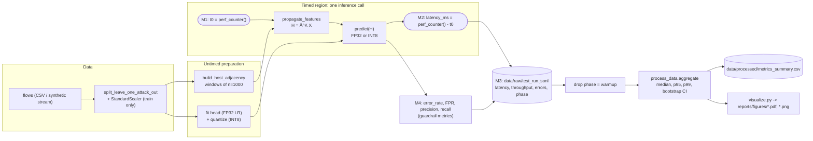

# Domain Model (ML track): loss function, target metrics, notation

Formal definition of the learning problem implemented in `src/` (Week 9 artifact). Every symbol below corresponds to a variable in the code; the *Code* column of the notation table gives the mapping.

## 1. Problem setting: leave-one-attack-out zero-day detection

Let $\mathcal{F}=\{f_1,\dots,f_N\}$ be a chronologically ordered stream of network flows, each with a feature vector $\mathbf{x}_i\in\mathbb{R}^{d}$ ($d=4$: `duration, pkts, bytes, mean_iat`, standardized with a scaler fitted on train only) and a binary label $y_i\in\{0,1\}$ (0 = benign, 1 = attack). Attack flows belong to families $a_i\in\mathcal{A}\cup\{\text{benign}\}$.

For each held-out family $a^\star\in\mathcal{A}$ the data are split as

$$
\mathcal{D}_{\text{train}}=\{f_i: a_i=\text{benign},\ i\le \tau\}\cup\{f_i: a_i\in\mathcal{A}\setminus\{a^\star\}\},\qquad
\mathcal{D}_{\text{test}}=\{f_i: a_i=\text{benign},\ i>\tau\}\cup\{f_i: a_i=a^\star\},
$$

where $\tau$ is the chronological index after the first 60 % of benign flows. The held-out family is therefore **absent from training** (zero-day condition).

## 2. Graph construction and propagation

Flows are processed in windows of $n=1000$ flows (bounds the $O(n^2)$ adjacency). Inside a window, nodes are flows; $A_{ij}=A_{ji}=1$ if flows $i<j$ are *consecutive* occurrences of the same host IP. With self-loops $\tilde A=A+I$ and degree matrix $\tilde D_{ii}=\sum_j\tilde A_{ij}$:

$$
\hat A=\tilde D^{-1/2}\,\tilde A\,\tilde D^{-1/2},\qquad
H=\hat A^{K}X,\quad K=2 \ \text{(hops)},
$$

applied independently per window (block-diagonal $\hat A$). The propagation has **no trainable parameters**; only the linear head is learned.

## 3. Loss function

The head is an $\ell_2$-regularized logistic regression (`sklearn.linear_model.LogisticRegression`, $C=1$). With $\mathbf{h}_i$ the $i$-th row of $H$ (for the flat baseline $\mathbf{h}_i=\mathbf{x}_i$), logit $z_i=\mathbf{w}^\top\mathbf{h}_i+b$ and probability $p_i=\sigma(z_i)=1/(1+e^{-z_i})$:

$$
\mathcal{L}(\mathbf{w},b)\;=\;\frac12\lVert\mathbf{w}\rVert_2^2\;+\;C\sum_{i\in\mathcal{D}_{\text{train}}}\Big[-y_i\log p_i-(1-y_i)\log(1-p_i)\Big]
$$

Prediction: $\hat y_i=\mathbb{1}[z_i\ge 0]$.

### INT8 head (proposed method)

After training, parameters and inputs are quantized symmetrically. For a tensor $\mathbf{v}$:

$$
s_v=\frac{\max|\mathbf{v}|}{127},\qquad q(\mathbf{v})=\operatorname{clip}\!\big(\operatorname{round}(\mathbf{v}/s_v),\,-127,\,127\big)\in\{-127,\dots,127\}
$$

$$
\hat z_i\;=\;s_h\,s_w\,\big\langle q(\mathbf{h}_i),\,q(\mathbf{w})\big\rangle_{\text{INT32}}\;+\;s_b\,q(b),\qquad \hat y_i=\mathbb{1}[\hat z_i\ge 0].
$$

The integer dot product is accumulated in INT32 to avoid overflow. In the current skeleton only the head is quantized; $\hat A^K X$ remains FP32.

## 4. Target metrics

**Detection (computed on $\mathcal{D}_{\text{test}}$; $TP,FP,TN,FN$ counted for the attack class):**

$$
\text{Precision}=\frac{TP}{TP+FP},\quad
\text{Recall}=\frac{TP}{TP+FN},\quad
F_1=\frac{2\,\text{Precision}\cdot\text{Recall}}{\text{Precision}+\text{Recall}},
$$

$$
\text{FPR}=\frac{FP}{FP+TN},\qquad
\text{DR}_{a^\star}=\frac{1}{|\mathcal{D}_{a^\star}|}\sum_{i\in\mathcal{D}_{a^\star}}\hat y_i\ \ (\text{zero-day detection rate}),\qquad
\varepsilon=\frac{FP+FN}{N_{\text{batch}}}\ \ (\text{error rate, guardrail}).
$$

**Performance (per inference call $r$ on a batch of $L$ flows):**

$$
t_r=\text{wall-clock time of } \hat y=\text{predict}(\hat A^K X)\ \text{[ms]},\qquad
\text{Throughput}_r=\frac{L}{t_r\cdot 10^{-3}}\ \text{[flows/s]}.
$$

Warm-up calls $r<R_w$ ($R_w=5$) are discarded. Over the evaluation calls $\mathcal{R}$:

$$
\tilde t=\operatorname{median}_{r\in\mathcal{R}}(t_r),\qquad
p_q=\text{empirical } q\text{-quantile of } \{t_r\}\ (q=0.95,0.99),\qquad
\text{CI}_{95\%}(\tilde t)=\big[Q_{0.025}(\tilde t^{*}),\,Q_{0.975}(\tilde t^{*})\big],
$$

with $\tilde t^{*}$ the medians of $B=5000$ bootstrap resamples (seed 42).

**Hypothesis H1 (latency) and guardrails:**

$$
\rho(L)=\frac{\tilde t_{\text{INT8}}(L)}{\tilde t_{\text{FP32}}(L)},\qquad
\text{H1 holds at load } L \iff \rho^{\text{upper}}_{95\%}(L)<0.70,
$$

$$
\text{Guardrails (INT8):}\quad \text{Precision}\ge 0.92,\qquad F_1^{\text{FP32}}-F_1^{\text{INT8}}\le 0.02 .
$$

## 5. Notation table

| Symbol | Meaning | Unit | Code |
|:---|:---|:---|:---|
| $N$ | number of flows in the stream | – | `len(df)` |
| $d$ | number of flow features (4) | – | `config.data.feature_cols` |
| $\mathbf{x}_i\in\mathbb{R}^d$ | standardized feature vector of flow $i$ | – | `X_train`, `X_test` |
| $y_i,\ \hat y_i$ | true / predicted label (1 = attack) | – | `y_test`, `pred` |
| $a_i,\ a^\star$ | attack family of flow $i$ / held-out (zero-day) family | – | `attack_type`, `held_out_attack` |
| $\mathcal{D}_{\text{train}},\mathcal{D}_{\text{test}}$ | leave-one-attack-out splits | – | `split_leave_one_attack_out` |
| $n$ | flows per graph window | flows | `window_size` (1000) |
| $A,\tilde A,\tilde D,\hat A$ | adjacency, adjacency + self-loops, degree matrix, normalized adjacency | – | `build_host_adjacency` |
| $K$ | number of propagation hops (2) | – | `hops` |
| $H=\hat A^K X$ | propagated features | – | `propagate_features` |
| $\mathbf{w},b$ | head weights / bias | – | `head.coef_`, `head.intercept_` |
| $C$ | inverse regularization strength (1.0) | – | sklearn default |
| $\mathcal{L}$ | training loss (L2-regularized cross-entropy) | – | `LogisticRegression` objective |
| $\sigma(\cdot)$ | logistic sigmoid | – | – |
| $s_v,\ q(\cdot)$ | INT8 scale / quantizer | – | `GNNINT8Model._quantize` |
| $TP,FP,TN,FN$ | confusion-matrix counts (attack = positive) | flows | `evaluate_predictions` |
| $\text{FPR},\ \text{DR}_{a^\star},\ \varepsilon$ | false-positive rate, zero-day detection rate, error rate | – | `fpr`, `unseen_recall_dr`, `error_rate` |
| $L$ | load: flows scored per inference call | flows | `load_flows` |
| $t_r$ | latency of call $r$ | ms | `latency_ms` |
| $R_w$ | warm-up calls discarded per configuration (5) | calls | `WARMUP` |
| $\tilde t,\ p_{95},\ p_{99}$ | median / 95th / 99th percentile latency | ms | `lat_median`, `lat_p95`, `lat_p99` |
| $B$ | bootstrap resamples (5000) | – | `N_BOOT` |
| $\rho(L)$ | latency ratio INT8/FP32 | – | `latency_ratio_table` |

## 6. Where metrics are collected

**M1–M2** time exactly the inference callable used in `src/benchmark.py` (propagation + head; adjacency construction and model fitting are excluded). **M3** persists one JSON line per call, including the phase tag (`warmup` / `eval`). **M4** records guardrail metrics for every call.
